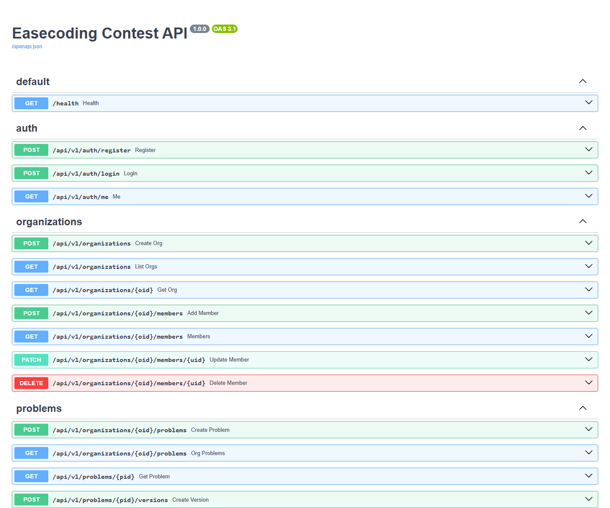

# Shodh AI Backend Engineer Assesment

FastAPI / SQLAlchemy 2.0 API for contest setup, submissions and a minimal Python 3.12 judge worker.



## Stage status

| Item | Status | Notes |
| --- | --- | --- |
| Stage 1 schema, authentication, organizations, problems, contests and submissions | REAL | MySQL-backed API and Alembic migrations. |
| Stage 1 verdicts and leaderboard | REAL | Verdict service and authoritative-verdict leaderboard query. |
| Python stdin judge | REAL | Docker sandbox with compile check, resource limits and bounded output. |
| Function-style judge drivers | REAL | JSON argument functions and linked-list `ListNode` driver run in the same Docker sandbox. |
| Outbox worker, leases and bounded recovery | REAL | MySQL polling worker; Docker socket access remains a deployment isolation limit. |
| Submission idempotency and rejudge | REAL | MySQL constraints and transaction-backed API behavior. |
| Load-test evidence | PARTIAL | Submission endpoint exercise only; not a capacity or leaderboard benchmark. |
| Multi-tenant hardened execution isolation | PARTIAL | Requires a dedicated disposable VM or restricted rootless Docker/socket proxy. |

## Run

1. Create a MySQL 8 database and copy `.env.example` to `.env`; set `DATABASE_URL` and a strong `JWT_SECRET`.
2. Install dependencies: `python -m pip install -r requirements.txt`.
3. Apply schema: `alembic upgrade head`.
4. Start: `uvicorn app.main:app --reload`; Swagger is at `/docs`.

Or run `docker compose up --build -d`. Compose starts MySQL, the API and the separate `python -m app.worker` process. The API applies Alembic migrations on startup. Set `API_PORT` and `MYSQL_PORT` when their default host ports are occupied.

Run the database-backed suite (the Python judge tests require the worker service's Docker socket):

```sh
docker compose stop worker
docker compose run --rm --no-deps worker python -m pytest -q
docker compose start worker
```

Seed examples with `docker compose exec api python -m scripts.seed_dev`. The idempotent seed publishes Two Number Sum, String Rotation, Grid Paths and Reverse Linked List, each with two visible examples and five hidden cases, plus queued sample programs.

## Idempotency

Submission requests may include an `Idempotency-Key` header of up to 128 characters. The key is scoped to the authenticated user and contest. Its SHA-256 fingerprint is calculated from canonical JSON containing `contest_problem_id`, `source_code` and `language`. Repeating the key with the same values returns the original submission with HTTP 200 and `Idempotent-Replayed: true`; changing any of those values returns HTTP 409 (`IDEMPOTENCY_KEY_REUSED`). The submission, first attempt, outbox event and key record are committed together. Replays still require the caller to be registered for the contest.

## Implemented Engineering Features

- **Submission benchmarking:** Implemented load testing for the submission endpoint.
- **Isolated code execution:** Each test case runs in a separate Docker container with CPU, memory and process limits.
- **Reliable job processing:** Implemented database-backed worker leases, automatic retries and infrastructure failure handling.
- **Idempotent submissions:** Prevented duplicate submissions using user-scoped, contest-specific idempotency keys and SHA-256 request fingerprints.
- **Safe rejudging:** Implemented rejudging through separate attempts while preserving previous execution history.
- **Multi-tenant access control:** Enforced organization-level and participant-level authorization across submission and contest operations.
- **Protected test-case data:** Restricted hidden inputs, expected outputs and private execution diagnostics from participant access.
- **Transactional job creation:** Submission records, attempts, outbox events and idempotency records are committed together.
